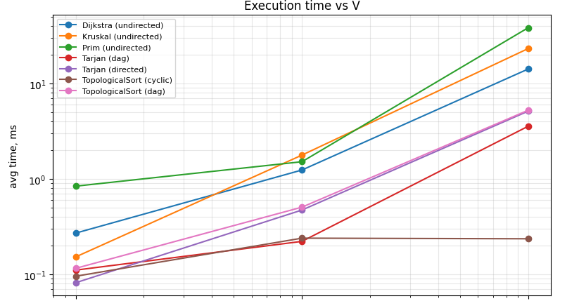
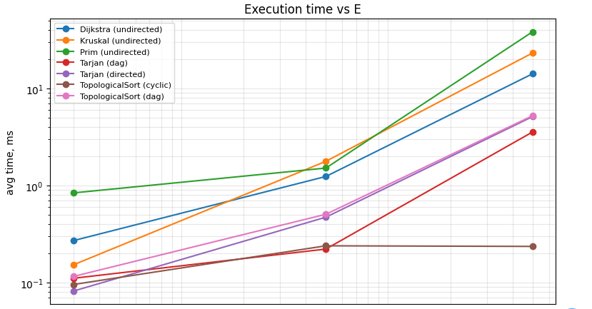
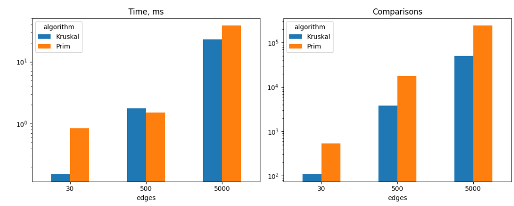
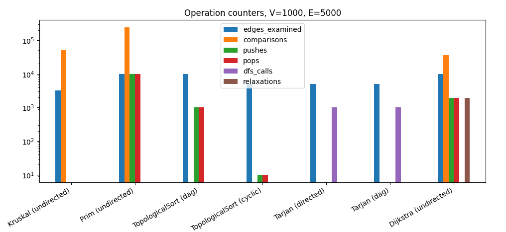

# Assignment 3: Graph Algorithms (DSU, MST, SCC, Topological Sort, Dijkstra)

## Overview

This project implements six graph components in plain Java, with no external libraries:

- DSU (disjoint set union) with path compression and union by rank
- Kruskal's minimum spanning tree algorithm
- Prim's minimum spanning tree algorithm
- Tarjan's strongly connected components (SCC)
- Topological ordering (Kahn's algorithm) with cycle detection
- Dijkstra's shortest paths

Every algorithm returns a result object that holds the answer, the running time measured with `System.nanoTime()`, and operation counters (edges examined, comparisons, DSU calls, heap pushes and pops, DFS calls, relaxations). The benchmark and the tests read these counters, so nothing is counted outside the algorithms themselves.

### Graph representation

`Graph` stores the vertex count, a `directed` flag, one list with all edges and one adjacency list per vertex. An `Edge` has `from`, `to` and a `double` weight.

For an undirected graph, `addEdge(u, v, w)` puts a single edge into the global edge list and two entries into the adjacency lists (u to v and v to u). So `getEdgeCount()` returns E, while the adjacency lists hold 2E entries. This matters later: Prim and Dijkstra walk the adjacency lists and therefore examine 2E entries on an undirected graph.

### Project structure

```
src/
  graph/          Edge, Graph, GraphGenerator
  dsu/            DSU
  mst/            Kruskal, Prim, MSTResult
  connectivity/   TarjanSCC, TopologicalSort, SCCResult, TopoResult
  shortestpath/   Dijkstra, PathResult
  benchmark/      Benchmark (writes results/tables/benchmark.csv)
  test/           AlgorithmTests (writes results/tables/tests.csv)
  Main.java       small demo of every algorithm
results/
  tables/         benchmark.csv, tests.csv
  plots/          PNG files used in this report
README.md
```


## Implementation

### DSU

Two int arrays, `parent` and `rank`. `find` is recursive and compresses the path: every node visited on the way up is pointed straight at the root. `union` finds both roots and hangs the tree with the smaller rank under the other one, and increments the rank only when the ranks are equal. The class also keeps the number of components and counts `find` and `union` calls. `union` calls `find` twice, so `find_ops` is always exactly twice `union_ops` in the tables. Note that `union_ops` counts calls, not successful merges. For example, at V = 1000 Kruskal makes 3271 union calls, but only 999 of them merge two components.

### Kruskal

Kruskal copies the edge list and sorts it with a comparator that increments a counter, so `comparisons` is the real number of comparisons made by the sort. Then it goes through the sorted edges and calls `union`. It stops as soon as one component is left, which is why `edges_examined` is below E on connected graphs (3271 of 5000 on the large graph). On a disconnected graph it returns a minimum spanning forest and sets `connected = false`.

### Prim

This is the lazy version with `java.util.PriorityQueue`. When a vertex is visited, all of its adjacency entries are pushed into the heap. A popped edge is skipped if its target was already visited. The outer loop starts a new search from every unvisited vertex, so on a disconnected graph Prim also returns a forest, and `connected` tells how many components were found. Every adjacency entry is pushed exactly once, so `pushes` equals 2E and, since the heap is emptied completely, `pops` equals `pushes`.

### Topological sort

Kahn's algorithm. First it computes in-degrees (this pass costs E), then it repeatedly takes a vertex with in-degree zero from a queue and decrements its neighbours. If fewer than V vertices were taken out, the graph has a cycle. In that case the result has `hasCycle = true` and an empty order.

### Tarjan SCC

Recursive DFS with `index`, `lowLink` and an explicit stack. When `lowLink[v] == index[v]`, the vertices above `v` on the stack form one component. The result has both the list of components and a `componentOf` array. The recursion depth can reach V, which is fine for V = 1000 but would need an iterative version for graphs with hundreds of thousands of vertices.

### Dijkstra

Binary heap with lazy deletion: instead of decreasing a key, a new node is pushed whenever a shorter distance is found, and outdated nodes are skipped when popped. Distances are `double`, unreachable vertices keep `Double.POSITIVE_INFINITY`. The algorithm rejects negative weights up front with an `IllegalArgumentException`, because the correctness argument for Dijkstra breaks with them. `relaxations` counts successful distance updates.

### Validators

Three methods are used by the tests and the demo: `TopologicalSort.isValidOrder` (every edge goes forward in the order, every vertex appears once), `TarjanSCC.isValidPartition` (every vertex is in exactly one component) and `Dijkstra.isValid` (no edge can improve a distance, and every parent pointer is consistent with the distances).

## Complexity Analysis

Assumptions: graphs are stored as adjacency lists, priority queues are binary heaps, and V and E are the numbers of vertices and edges. Since E is at most V squared, log E is at most 2 log V, so O(log E) and O(log V) are interchangeable. Below, α is the inverse Ackermann function, which stays below 5 for any input size that fits in memory.

| Algorithm | Time | Extra space |
|---|---|---|
| DSU find / union (both optimizations) | O(α(V)) amortized | O(V) |
| Kruskal | O(E log E) = O(E log V) | O(V + E) |
| Prim (lazy, binary heap) | O(E log E) = O(E log V) | O(V + E) |
| Tarjan SCC | O(V + E) | O(V) |
| Topological sort (Kahn) | O(V + E) | O(V) |
| Dijkstra (lazy, binary heap) | O(E log V) | O(V + E) |

### DSU

Without any optimization a union can create a chain, and `find` then walks up to V nodes, so one operation costs O(V). Union by rank alone keeps the height of every tree at most log2 V, so `find` costs O(log V). Path compression alone gives O(log V) amortized, because each long walk flattens the nodes it passes. With both together, a sequence of m operations on V elements costs O(m α(V)), which is practically constant per operation. A useful side effect in this implementation: since the rank bounds the tree height, the recursion in `find` is never deeper than log V.

V affects only the size of the two arrays. E affects how many `find` and `union` calls Kruskal makes, at most 2E finds.

### Kruskal

Sorting E edges costs O(E log E) and dominates everything else. The loop makes at most E union calls, which cost O(E α(V)) in total. So Kruskal depends mostly on E, and V matters only through the DSU arrays and the stopping condition (V minus 1 successful unions). Space is O(E) for the sorted copy plus O(V) for the DSU and the result.

### Prim

Each adjacency entry is pushed into the heap once and popped once, 2E pushes in total for an undirected graph. Each heap operation costs O(log E), so the total is O(E log E). The heap can hold up to 2E entries at the same time, hence O(E) space, plus O(V) for the visited array. Prim grows with E first. V matters through the number of vertex visits, but visits are dominated by the edge work.

### Tarjan SCC

Every vertex starts a DFS call once and every edge is looked at once, so the time is O(V + E). The arrays `index`, `lowLink`, `componentOf`, `onStack` and the stack take O(V). The recursion stack can also reach depth V.

### Topological sort

Computing in-degrees costs E, the queue processes each vertex once, and each edge is looked at once more when its source is removed. The total is O(V + E), space O(V) for in-degrees, the queue and the order. On a graph with a cycle the algorithm stops earlier, but the worst case stays O(V + E).

### Dijkstra

Each successful relaxation pushes one node, so the heap sees at most E pushes (plus the source) and the same number of pops. At O(log E) per heap operation the total is O(E log V). With a binary heap and lazy deletion the heap can hold O(E) nodes, and distances and parents take O(V). The scan over the adjacency lists costs O(V + E), which is smaller than the heap term for connected graphs. Performance depends on E more than on V, and the real number of pushes is usually far below E because only improving edges are pushed.

## Experimental Setup

### Graph sizes

| Graph | V | E | E / V |
|---|---|---|---|
| Small | 10 | 30 | 3 |
| Medium | 100 | 500 | 5 |
| Large | 1000 | 5000 | 5 |

Medium and large have the same density, only small is sparser relative to V.

### Generation

All graphs are generated by `GraphGenerator` with a fixed seed (42), so every run produces the same graphs and the operation counters are reproducible exactly. Weights are random integers from 1 to 100. Graph generation is outside the measured time.

- Connected undirected graph (for MST and Dijkstra). The vertices are shuffled, and each vertex in the shuffled order is attached to a random vertex that already stands before it. This gives a random spanning tree with V - 1 edges, so the graph is connected by construction. Then random vertex pairs are added, skipping self loops and duplicates, until E edges exist.
- Directed graph (for SCC and the cyclic topological sort case). Random ordered pairs (a, b) with a different from b, no duplicate pairs, until E edges exist. Nothing prevents cycles, and with E = 3V to 5V they appear almost surely. The topological sort confirms this: it reports a cycle on all three sizes (at V = 1000 it removes only 10 vertices from the queue before getting stuck).
- DAG (for topological sort and SCC). A random permutation of the vertices is chosen as a hidden order. Random pairs of positions i < j are drawn and an edge goes from the vertex at position i to the vertex at position j. All edges go forward in the hidden order, so a cycle is impossible.

### Measurement

- Time is measured inside each algorithm with `System.nanoTime()`, from the start of `run` to just before the result object is built. It includes allocation of the algorithm's own structures and excludes graph generation.
- Each experiment runs 3 warm-up iterations (not recorded, they let the JIT compile the code) and then 5 recorded repeats. The table shows the average of the 5.
- Operation counters come from the last repeat. The algorithms are deterministic on a fixed graph, so the counters are identical in every repeat.
- Dijkstra runs from vertex 0 on the connected undirected graph, so every vertex is reachable.
 ### Hardware and Software Environment

- **CPU:** AMD Ryzen 5 3550H
- **RAM:** Approximately 6 GB available to the system
- **Operating System:** Windows 10 Pro 64-bit
- **Java Version:** OpenJDK 25.0.1 (64-bit)
- **JVM:** OpenJDK 64-Bit Server VM, build 25.0.1+8-27

## Results

### Benchmark table

| Algorithm | Graph | Vertices | Edges | Avg. Time (ns) | Edges Examined | Comparisons | Find Ops | Union Ops | Pushes | Pops | DFS Calls | Relaxations |
|---|---|---:|---:|---:|---:|---:|---:|---:|---:|---:|---:|---:|
| Kruskal | undirected | 10 | 30 | 152360 | 15 | 109 | 30 | 15 | 0 | 0 | 0 | 0 |
| Prim | undirected | 10 | 30 | 838320 | 60 | 532 | 0 | 0 | 60 | 60 | 0 | 0 |
| TopologicalSort | dag | 10 | 30 | 115700 | 60 | 0 | 0 | 0 | 10 | 10 | 0 | 0 |
| TopologicalSort | cyclic | 10 | 30 | 95600 | 30 | 0 | 0 | 0 | 0 | 0 | 0 | 0 |
| Tarjan | directed | 10 | 30 | 81760 | 30 | 0 | 0 | 0 | 0 | 0 | 10 | 0 |
| Tarjan | dag | 10 | 30 | 110800 | 30 | 0 | 0 | 0 | 0 | 0 | 10 | 0 |
| Dijkstra | undirected | 10 | 30 | 270400 | 60 | 79 | 0 | 0 | 18 | 18 | 0 | 17 |
| Kruskal | undirected | 100 | 500 | 1772380 | 180 | 3839 | 360 | 180 | 0 | 0 | 0 | 0 |
| Prim | undirected | 100 | 500 | 1511140 | 1000 | 17410 | 0 | 0 | 1000 | 1000 | 0 | 0 |
| TopologicalSort | dag | 100 | 500 | 505500 | 1000 | 0 | 0 | 0 | 100 | 100 | 0 | 0 |
| TopologicalSort | cyclic | 100 | 500 | 239360 | 500 | 0 | 0 | 0 | 0 | 0 | 0 | 0 |
| Tarjan | directed | 100 | 500 | 471600 | 500 | 0 | 0 | 0 | 0 | 0 | 100 | 0 |
| Tarjan | dag | 100 | 500 | 221560 | 500 | 0 | 0 | 0 | 0 | 0 | 100 | 0 |
| Dijkstra | undirected | 100 | 500 | 1237620 | 1000 | 2438 | 0 | 0 | 203 | 203 | 0 | 202 |
| Kruskal | undirected | 1000 | 5000 | 23121820 | 3271 | 50394 | 6542 | 3271 | 0 | 0 | 0 | 0 |
| Prim | undirected | 1000 | 5000 | 38201200 | 10000 | 241459 | 0 | 0 | 10000 | 10000 | 0 | 0 |
| TopologicalSort | dag | 1000 | 5000 | 5226560 | 10000 | 0 | 0 | 0 | 1000 | 1000 | 0 | 0 |
| TopologicalSort | cyclic | 1000 | 5000 | 235940 | 5054 | 0 | 0 | 0 | 10 | 10 | 0 | 0 |
| Tarjan | directed | 1000 | 5000 | 5115480 | 5000 | 0 | 0 | 0 | 0 | 0 | 1000 | 0 |
| Tarjan | dag | 1000 | 5000 | 3555420 | 5000 | 0 | 0 | 0 | 0 | 0 | 1000 | 0 |
| Dijkstra | undirected | 1000 | 5000 | 14118860 | 10000 | 35543 | 0 | 0 | 1933 | 1933 | 0 | 1932 |

### Plots

Execution time against the number of vertices:



Execution time against the number of edges:



Kruskal against Prim, time and comparisons:



Operation counters on the large graph (V = 1000, E = 5000):



Both axes of the first two plots are logarithmic. V and E grow together in the three configurations (10/30, 100/500, 1000/5000), so the two plots show almost the same curves. They are not independent experiments.

## Comparison and Discussion

### Kruskal against Prim

On the large graph Kruskal made 50,394 comparisons and Prim made 241,459, about 4.8 times more. The reason is visible in the counters. Kruskal sorts E = 5000 edges and stops after examining 3271 of them. Lazy Prim pushes every adjacency entry into the heap, 10,000 pushes and 10,000 pops, and each heap operation costs several comparisons. The measured time follows the same direction: 23.1 ms for Kruskal and 38.2 ms for Prim.

At the medium size the counters differ by a similar factor (3839 against 17,410 comparisons), but Prim was slightly faster in time (1.51 ms against 1.77 ms). So comparison counts and time do not line up exactly at small sizes, where allocation, JIT compilation and cache effects are a large part of a run that lasts around a millisecond. On the small graph Prim took 838 µs against 152 µs for Kruskal, and that Prim value is larger than its own value on the medium graph. A graph with ten vertices cannot be harder than one with a hundred, so this number reflects measurement noise, not the algorithm. I treat the small-size times as unreliable and rely on the counters for that size.

Both algorithms return the same weight in every test, as expected. Kruskal looks better on these sparse graphs. Prim with a heap would be more attractive with a decrease-key operation (so the heap holds at most V entries) or on dense graphs, but I did not test those variants.

### DSU

The benchmark does not switch the optimizations off, so there is no measured comparison of the four DSU variants. What the counters do show is that the DSU is cheap compared with the sort: on the large graph Kruskal makes 6542 `find` calls against 50,394 sort comparisons. This agrees with the theory in the Complexity Analysis section. Path compression flattens the trees, so repeated finds on the same nodes cost one step. Union by rank keeps trees shallow from the start. Together they make the DSU part of Kruskal nearly linear in E, and the sort is the real bottleneck.

### SCC

For Tarjan on the directed graphs, `dfs_calls` equals V and `edges_examined` equals E at every size (10/30, 100/500, 1000/5000), exactly as the O(V + E) analysis says. The time grew by a factor of about 10.8 between the medium and the large graph, while V + E grew by 10 (from 600 to 6000). That is close to linear. From small to medium the time grew only 5.8 times while V + E grew 15 times, because a run on ten vertices is dominated by fixed costs. Tarjan on the DAG behaves the same way in terms of counters, since a DAG just has every vertex as its own component.

### Topological ordering

On the DAGs Kahn's algorithm examines 2E edges (E for the in-degree pass and E while processing), and pushes and pops both equal V. On the random directed graphs it finds the cycle at all three sizes. At V = 1000 it examines 5054 edges, which is the 5000 of the in-degree pass plus 54 more, and it removes only 10 vertices from the queue. The time is 0.24 ms against 5.2 ms for the DAG. This is not a sign that cycle detection is faster in general. It happens because the algorithm gets stuck almost immediately on these graphs, so the cyclic time is not comparable with the DAG time.

### Dijkstra

The counters grow slowly: pushes are 18, 203 and 1933, relaxations are 17, 202 and 1932 (always pushes minus one for the source), and edges examined are 2E. At the large size Dijkstra pushes only about 1.9 times V entries, far fewer than E, because it pushes only when a distance improves. Prim in the same graph pushes 10,000 entries. This is one reason why Dijkstra (14.1 ms) is cheaper than lazy Prim (38.2 ms) on the same graph even though the two algorithms look alike.

### Theory against experiment

The exact counters match the theory everywhere: 2E examined entries for Prim and Dijkstra, V DFS calls and E examined edges for Tarjan, 2E examined edges on a DAG for Kahn. For times, the growth from medium to large is the only comparison I trust. Kruskal's time grew 13.0 times, and E log E grows 13.7 times between 500 and 5000 edges, a close match. Topological sort on the DAG grew 10.3 times against 10 for V + E. Dijkstra grew 11.4 times against about 15 predicted by E log V. Prim grew 25 times, more than any of the formulas predicts, which I attribute to heap memory behavior and garbage collection, though I did not verify that.

### Limitations

- Only three sizes, one graph per size and one seed. Three points cannot confirm a complexity class, they can only show that the trend is consistent with it.
- Medium and large share the same density (E / V = 5), and V and E never vary independently.
- Times for the small graph are dominated by JVM noise.
- Dijkstra was run from a single source only.
- Times come from one machine, and the 5 repeats are averaged, not medianed, as the assignment requires.

## Testing

`AlgorithmTests` runs 40 checks without any test framework and prints PASS or FAIL for each. It also saves the results to `results/tables/tests.csv`. The assignment lists seven kinds of graphs and five properties to verify. All of them are covered:

| Required case | What is tested |
|---|---|
| Small graphs | 4-vertex graph with a known MST weight of 6, and a 6-vertex road graph with a known shortest path of length 20 |
| Disconnected graphs | Kruskal and Prim both return a forest of weight 10 with V - 2 edges and `connected = false` |
| Graphs with cycles | Topological sort reports the cycle and returns no order, SCC finds the cycle as one component |
| Multiple valid MSTs | A 4-cycle with all weights equal to 1: both algorithms return weight 3 |
| Unreachable vertices | Dijkstra gives infinite distance and an empty path, compared with a reference solution on random graphs too |
| Duplicate edge weights | The complete graph K5 with all weights equal to 1, plus 100 random graphs with weights from 1 to 3 |
| Single vertex | Weight 0 and no edges for both MST algorithms, order `[0]`, one SCC, distance 0 |

| Required check | How it is done |
|---|---|
| Kruskal and Prim return the same weight | 100 random connected graphs with different seeds, comparing total weight (not edge sets, because several MSTs can exist) |
| Topological order valid for every DAG | 100 random DAGs, each order checked with `isValidOrder`, and no false cycle reports |
| Cycles identified | Fixed 3-cycle, plus 100 random directed graphs where cycle detection must agree with the SCC result (a cycle exists exactly when some component has more than one vertex) |
| Every vertex in exactly one SCC | `isValidPartition` on fixed and on 100 random directed graphs |
| Dijkstra correct for non-negative weights | 100 random graphs (half directed, half undirected) compared with a Bellman-Ford implementation written inside the test class, plus `isValid` on each result. Negative weights must raise an exception. |

Test results table:
| ID | Check | Result |
|---:|---|:---:|
| 1 | Small: Kruskal weight = 6 | PASS |
| 2 | Small: Prim weight = 6 | PASS |
| 3 | Small: MST has V-1 edges | PASS |
| 4 | Small: connected flag | PASS |
| 5 | Disconnected: Kruskal forest weight = 10 | PASS |
| 6 | Disconnected: Prim forest weight = 10 | PASS |
| 7 | Disconnected: forest has V-2 edges | PASS |
| 8 | Disconnected: connected = false | PASS |
| 9 | Multiple MST: Kruskal weight = 3 | PASS |
| 10 | Multiple MST: weights equal | PASS |
| 11 | Duplicate weights K5: Kruskal = 4 | PASS |
| 12 | Duplicate weights K5: Prim = 4 | PASS |
| 13 | Single vertex: Kruskal weight 0, no edges, connected | PASS |
| 14 | Single vertex: Prim weight 0, no edges, connected | PASS |
| 15 | Single vertex: topo order is empty, no cycle | PASS |
| 16 | Single vertex: one SCC | PASS |
| 17 | Single vertex: dist[0] = 0 | PASS |
| 18 | Cycle: detected by topological sort | PASS |
| 19 | Cycle: no order returned | PASS |
| 20 | DAG: no cycle | PASS |
| 21 | DAG: order is valid | PASS |
| 22 | SCC: valid partition | PASS |
| 23 | SCC: 2 components | PASS |
| 24 | SCC: {0,1,2} together, 3 apart | PASS |
| 25 | SCC on DAG: every vertex is its own component | PASS |
| 26 | Unreachable: dist[2] = 8 | PASS |
| 27 | Unreachable: vertex 3 is unreachable | PASS |
| 28 | Unreachable: dist[3] = infinity | PASS |
| 29 | Unreachable: path to 3 is empty | PASS |
| 30 | Dijkstra: dist to 4 = 20 | PASS |
| 31 | Dijkstra: path to 4 = [0, 2, 5, 4] | PASS |
| 32 | Dijkstra: result passes isValid | PASS |
| 33 | Dijkstra: negative weight rejected | PASS |
| 34 | Random connected: Kruskal weight = Prim weight, V-1 edges | PASS |
| 35 | Random with duplicate weights: Kruskal = Prim | PASS |
| 36 | Random DAGs: valid topological order, no false cycle | PASS |
| 37 | Random directed: every vertex in exactly one SCC | PASS |
| 38 | Random directed: cycle detection agrees with SCC | PASS |
| 39 | Random graphs: Dijkstra = Bellman-Ford (including unreachable vertices) | PASS |
| 40 | Random graphs: Dijkstra result passes isValid | PASS |
| **Total** | **40 checks, 40 passed, 0 failed** | **PASS** |

## Conclusion

All six components work and pass all 40 checks. The operation counters follow the theoretical formulas exactly, and the measured times follow them at the sizes where measurement noise is small enough to see the trend.

Some guidance on when to use what, based on these results and the analysis:

- Kruskal is the simpler choice for sparse graphs given as an edge list, and in these experiments it did less work than lazy Prim. It also gives a spanning forest for free when the graph is disconnected.
- Prim is better suited to dense graphs or when the graph is already stored as adjacency lists and a decrease-key heap (or an array version for very dense graphs) is available. The lazy heap version used here is the simplest to write but pays for it with 2E pushes.
- Tarjan and Kahn are both linear, so they scale well. Tarjan answers connectivity questions on directed graphs (for example, which parts of a one-way road network can reach each other). Kahn gives a valid ordering of dependencies and doubles as a cycle detector.
- Dijkstra is the right tool for single-source shortest paths when weights are non-negative. With negative weights it must not be used, and the implementation refuses such input.
- The DSU with path compression and union by rank is fast enough that its cost is invisible next to sorting in Kruskal
